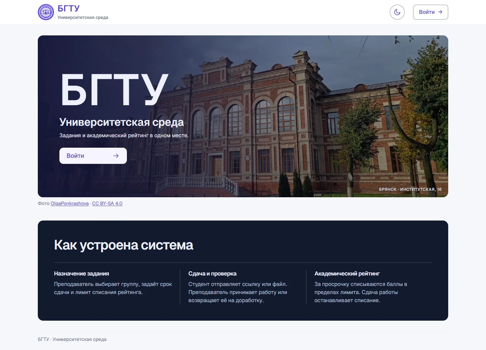
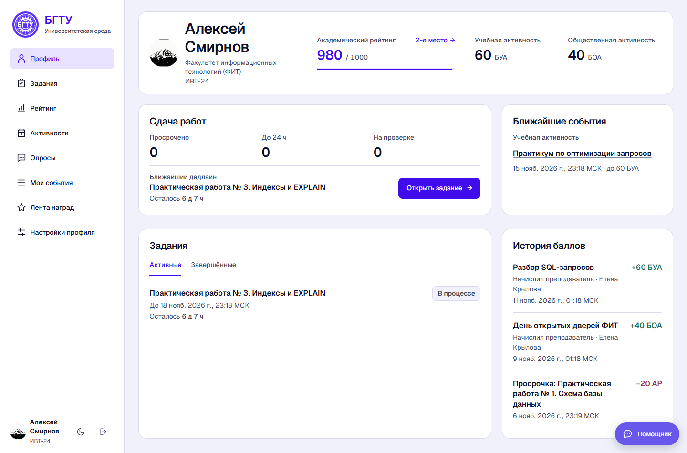
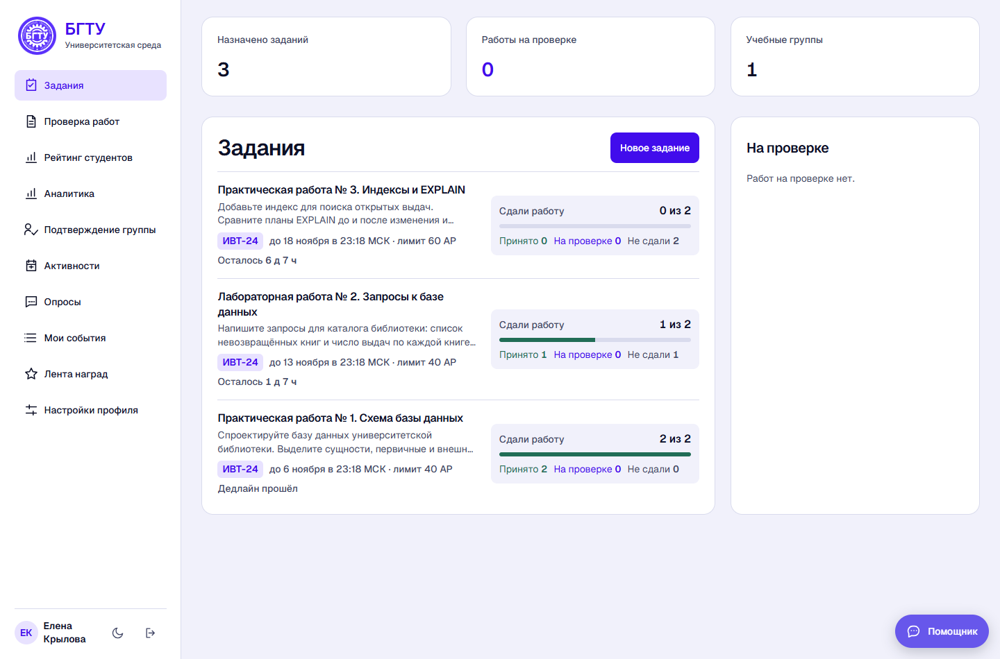
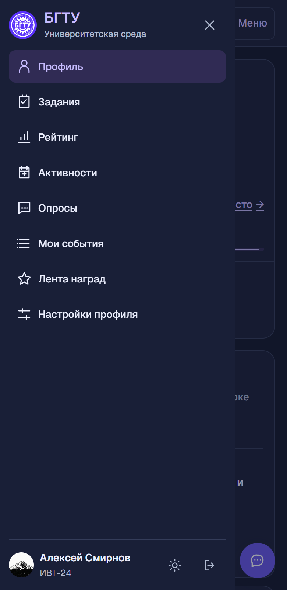

# БГТУ · Университетская среда

Проект для хакатона БГТУ 2026. Студенты сдают работы, следят за дедлайнами и рейтингом, участвуют в активностях. Преподаватели назначают задания группам, проверяют работы и начисляют баллы за участие.

**[Открыть демо](https://campusbgtu.ru/)** · [Быстрый старт](#быстрый-старт) · [Материалы хакатона](#материалы-хакатона)

[](https://campusbgtu.ru/)

## Что в кабинете

- **Студент** видит активные и завершённые задания, время до дедлайна, историю академического рейтинга (АР) и баллы за активности. Работу можно сдать файлом или ссылкой. В рейтинге есть фильтры по группе и факультету, собственное место и первые три позиции.
- **Преподаватель** назначает задания и активности, открывает вложения в очереди проверки, принимает работы или возвращает их на доработку. В аналитике видны динамика АР, рейтинги активности и расход бюджета начислений.
- **Администратор** ведёт справочники, назначает ответственных преподавателей, управляет подтверждением групп и настройками баллов. Ответственный преподаватель может назначить старосту, который подтверждает заявки своей группы.

В обоих кабинетах есть опросы, персональная лента событий и общая лента наград. Кампус отправляет уведомления по почте и в Telegram. Помощник находит нужный раздел, показывает студенту его задания и АР через MCP, помогает сдать работу или подготовить черновик задания.

## Скриншоты

<table>
  <tr>
    <th scope="col">Профиль студента</th>
    <th scope="col">Кабинет преподавателя</th>
  </tr>
  <tr>
    <td><a href="docs/screenshots/student.webp"></a></td>
    <td><a href="docs/screenshots/teacher.webp"></a></td>
  </tr>
</table>

<details>
<summary>Мобильное меню в тёмной теме</summary>

<br>
<a href="docs/screenshots/mobile-menu.webp"></a>

</details>

## Быстрый старт

После клонирования репозитория выполните в его корне одну команду. Docker Compose запустит приложение, PostgreSQL и Mailpit. Миграции, справочники и демо-данные загружаются автоматически.

```sh
docker compose up --build
```

Откройте [кампус](http://localhost:8080). Письма подтверждения и уведомления можно посмотреть в [Mailpit](http://localhost:8025).

На странице входа выберите демо-роль и нажмите «Войти». В локальном Compose доступны все три роли, на [публичном демо](https://campusbgtu.ru/) — студент и преподаватель.

<details>
<summary>Локальные демо-аккаунты</summary>

У всех демо-аккаунтов пароль `demo2026`.

- `student@bgtu.test` — Алексей Смирнов, ИВТ-24.
- `student2@bgtu.test` — Мария Волкова, ИВТ-24.
- `student3@bgtu.test` — Даниил Петров, ИВТ-25.
- `teacher@bgtu.test` — Елена Крылова, преподаватель.
- `admin@bgtu.test` — администратор.

</details>

### Сценарий для демо

1. Откройте кабинеты студента и преподавателя в обычном и приватном окнах. В локальном демо у ИВТ-24 уже есть задания по базам данных и сданная лабораторная с текстовым вложением.
2. Назначьте ИВТ-24 задание. Под студентом сдайте работу файлом или ссылкой.
3. Под преподавателем откройте «Проверка работ», посмотрите вложение и примите работу или верните её на доработку. Студент увидит новый статус в кабинете.

Повторный запуск Compose сохраняет состояние работ. Для проверки регистрации создайте аккаунт, подтвердите email через Mailpit и одобрите заявку студента в кабинете администратора. Источники факультетов, кафедр и групп указаны в [описании справочников](docs/spec/04-registration-catalogs.md).

## Стек

- **Сервер** — Java 21, Spring Boot 4.1, Spring Security и Maven.
- **Интерфейс** — React 19, TypeScript, Vite и PDF.js для предпросмотра PDF в очереди проверки.
- **Данные и запуск** — PostgreSQL 17, Flyway и Docker Compose. Spring Boot отдаёт интерфейс и REST API с одного адреса.

Параметры баллов, CSV-импорт, SMTP, Telegram, модели и VPS описаны в [настройке и развёртывании](docs/deployment.md).

## Проверки

Из `backend/` запустите `sh ./mvnw test` в Linux и macOS или `.\mvnw.cmd test` в Windows. Модульные тесты также выполняются при сборке Docker-образа.

Сборку интерфейса и Playwright запускайте из `frontend/`. Для сквозных тестов используйте отдельный демо-стенд.

```sh
npm ci
npm run build
npx playwright install chromium
npm run test:e2e
```

Чтобы прогнать только цикл заданий, выполните `npm run verify:assignments`. Адреса стенда и почты можно переопределить через `CAMPUS_URL` и `CAMPUS_MAILBOX_URL`. [Ручная проверка модулей](docs/agent-workflows/verify-base.md) · [Сценарий проверки заданий](docs/agent-workflows/verify-assignments.md) · [Аудит навигации](docs/agent-workflows/navigation-audit.md)

## Материалы хакатона

- [AGENTS.md](AGENTS.md) — контекст проекта, правила работы и команды для агента.
- [Требования](docs/spec/01-requirements.md), [архитектура](docs/spec/02-architecture.md) и [план разработки](docs/spec/03-plan.md).
- [Журнал работы с агентами](docs/agent-log.md) — задачи, найденные ошибки, исправления и результаты проверок.
- [Скилл `verify-campus`](.agents/skills/verify-campus/SKILL.md), [тесты рейтинга и баллов](backend/src/test/java/ru/bstu/campus/) и [сквозные тесты Playwright](frontend/e2e/).

## Фотография БГТУ

На главной и её скриншоте использована фотография OlgaPonkrashova. Дневная версия затемнена, ночная создана с помощью ИИ на основе оригинала. Оригинал и обработанные версии фотографии распространяются по CC BY-SA 4.0. [Оригинал на Wikimedia Commons](https://commons.wikimedia.org/wiki/File:Мужская_гимназияя.jpg) · [Лицензия CC BY-SA 4.0](https://creativecommons.org/licenses/by-sa/4.0/)
